# gemini-pro-mcp

[English](../README.md) · [Türkçe](README.tr.md) · [Русский](README.ru.md) · **Azərbaycanca**

**Google AI Pro abunəliyiniz Claude, Codex və Gemini CLI-nin içində.** Gemini 4 Argon, Deep Research, Flow videoları, Gemini Notebooks, Jules və artıq ödədiyiniz planın qalan imkanları, 36-ya qədər MCP aləti kimi. Bir əmrlə qurulur.

<p align="center"></p>

```bash
uvx gemini-pro-mcp setup
```

Faydalı olsa, bir ⭐ digər AI Pro istifadəçilərinin onu tapmasına kömək edir.

## Niyə

- **Gemini üçün əlavə hesab yoxdur.** `gemini_ask`, `gemini_research` və `gemini_code` Antigravity CLI vasitəsilə AI Pro planınızın limitləri ilə işləyir, ödənişli API açarı ilə yox.
- **Təkcə çat yox, bütün plan.** Deep Research, Google Flow (istənilən uzunluqda video və bütün Flow alətləri), Gemini Notebooks (Audio Overview, test, slaydlar), AI Mode, Jules və Gemini tətbiqi.
- **Kod agentiniz üçün ikinci beyin.** Claude və ya Codex sessiyadan çıxmadan Gemini-dən kod yoxlaması, mənbəli veb araşdırma və ya tapşırıq istəyə bilər.
- **Bir əmrlə qurulur, bir əmrlə yoxlanılır.** `setup` serveri tapdığı bütün klientlərə əlavə edir. `doctor` nəyin işlədiyini göstərir və işləməyəni necə düzəltməyi deyir.
- **Standart olaraq təhlükəsiz.** Gemini faylları sandbox-da oxuyur və `gemini_code` çağırılmasa heç nəyi dəyişmir. Pullu çağırışlar əvvəlcə icazə soruşur. Brauzer alətləri siz açana qədər bağlıdır, server Google parolunuzu heç vaxt görmür.

Agentinizdən belə şeylər istəyin:

> *"`src/auth.py` faylına Gemini-dən ikinci rəy al."*
> *"Flutter 3.47-də nəyin dəyişdiyini mənbələrlə araşdır."*
> *"Flow kreditlərimlə tülkünün qarlı meşədəki səyahəti haqqında 2 dəqiqəlik video düzəlt."*
> *"Bu üç PDF-i Gemini Notebook-a qoy və Audio Overview hazırla."*

## Quraşdırma

1. [uv](https://docs.astral.sh/uv/) quraşdırın.
2. Gemini alətləri üçün [Antigravity CLI](https://antigravity.google) quraşdırın, `agy` əmrini bir dəfə işə salın və Google AI Pro hesabınızla daxil olun.
3. Bu əmri işə salın:

```bash
uvx gemini-pro-mcp setup
```

`setup` kompüterinizdə Claude Code, Codex, Antigravity CLI və Gemini CLI-ni tapır, serveri hər birinə əlavə edir və nəyin işlədiyini yoxlayır. Sonra klientləri yenidən başladın.

- `--browser`: Flow, Gemini tətbiqi, AI Mode və Notebook alətlərini də açır. Sonra `gemini-pro-mcp flow-login` əmrini bir dəfə işə salıb açılan pəncərədə Google-a daxil olun.
- `--auto-approve`: pullu alətlər soruşmadan işləyir.
- `--dry-run`: heç nəyi dəyişmədən nə ediləcəyini göstərir.

Sonradan yoxlamaq üçün:

```bash
uvx gemini-pro-mcp doctor --flow
```

Media alətləri (`video_generate`, `image_generate`) üçün [Google AI Studio](https://aistudio.google.com/apikey)-dan API açarı lazımdır. Onu `~/.config/gemini-pro-mcp/.env` faylına `GEMINI_API_KEY=...` kimi yazın.

## Ətraflı

Bütün alətlər, qiymətlər, ayarlar və Flow bölməsi [ingiliscə README](../README.md)-dədir. Töhfə vermək istəyirsinizsə, [CONTRIBUTING.md](../CONTRIBUTING.md)-yə və [`good first issue`](https://github.com/Muzaqil555/gemini-pro-mcp/labels/good%20first%20issue) etiketli issue-lara baxın. Suallar üçün [Discussions](https://github.com/Muzaqil555/gemini-pro-mcp/discussions) açıqdır.

Bu müstəqil açıq mənbəli layihədir, Google və ya Anthropic ilə əlaqəsi yoxdur. Flow alətləri Google-un saytını avtomatlaşdırır, bu, Google-un qaydaları ilə ziddiyyət təşkil edə bilər. Öz riskinizlə istifadə edin. Lisenziya: [MIT](../LICENSE).
