# gemini-pro-mcp

[English](../README.md) · [Türkçe](README.tr.md) · **Русский** · [Azərbaycanca](README.az.md)

**Ваша подписка Google AI Pro внутри Claude, Codex и Gemini CLI.** Gemini 4 Argon, Deep Research, видео во Flow, Gemini Notebooks, Jules и всё остальное, за что вы уже платите, — до 36 инструментов MCP. Настраивается одной командой.

<p align="center"></p>

```bash
uvx --from git+https://github.com/Muzaqil555/gemini-pro-mcp gemini-pro-mcp setup
```

Если проект вам пригодился, ⭐ поможет другим пользователям AI Pro его найти.

## Зачем

- **Никаких отдельных счетов за Gemini.** `gemini_ask`, `gemini_research` и `gemini_code` работают через Antigravity CLI в пределах лимитов вашего плана AI Pro, а не через платный API-ключ.
- **Весь план, а не только чат.** Deep Research, Google Flow (видео любой длины и все инструменты Flow), Gemini Notebooks (Audio Overview, тесты, слайды), AI Mode, Jules и приложение Gemini.
- **Второй мозг для вашего код-агента.** Claude или Codex могут попросить у Gemini ревью кода, веб-исследование с источниками или правку, не выходя из сессии.
- **Одна команда для установки, одна для проверки.** `setup` добавляет сервер во все найденные клиенты. `doctor` показывает, что работает, и подсказывает, как исправить остальное.
- **Безопасно по умолчанию.** Gemini читает файлы в песочнице и ничего не меняет, пока не вызван `gemini_code`. Платные вызовы сначала спрашивают разрешение. Браузерные инструменты выключены, пока вы их не включите, а сервер никогда не видит ваш пароль Google.

Попросите агента, например:

> *«Узнай мнение Gemini о `src/auth.py`.»*
> *«Изучи, что изменилось во Flutter 3.47, с источниками.»*
> *«Сделай на мои кредиты Flow двухминутное видео о путешествии лисы по заснеженному лесу.»*
> *«Положи эти три PDF в Gemini Notebook и сделай Audio Overview.»*

## Установка

1. Установите [uv](https://docs.astral.sh/uv/).
2. Для инструментов Gemini установите [Antigravity CLI](https://antigravity.google), один раз запустите `agy` и войдите с аккаунтом Google AI Pro.
3. Выполните:

```bash
uvx --from git+https://github.com/Muzaqil555/gemini-pro-mcp gemini-pro-mcp setup
```

`setup` находит на компьютере Claude Code, Codex, Antigravity CLI и Gemini CLI, добавляет сервер в каждый из них и проверяет, что работает. Затем перезапустите клиенты.

- `--browser` — также включает инструменты Flow, приложения Gemini, AI Mode и Notebooks. После этого один раз выполните `gemini-pro-mcp flow-login` и войдите в Google в открывшемся окне.
- `--auto-approve` — платные инструменты работают без подтверждения.
- `--dry-run` — показывает изменения, ничего не меняя.

Проверить позже:

```bash
uvx --from git+https://github.com/Muzaqil555/gemini-pro-mcp gemini-pro-mcp doctor --flow
```

Для медиа-инструментов (`video_generate`, `image_generate`) нужен API-ключ из [Google AI Studio](https://aistudio.google.com/apikey). Запишите его в `~/.config/gemini-pro-mcp/.env` как `GEMINI_API_KEY=...`.

## Подробнее

Все инструменты, цены, настройки и раздел о Flow — в [README на английском](../README.md). Хотите помочь — загляните в [CONTRIBUTING.md](../CONTRIBUTING.md) и задачи с меткой [`good first issue`](https://github.com/Muzaqil555/gemini-pro-mcp/labels/good%20first%20issue). Вопросы — в [Discussions](https://github.com/Muzaqil555/gemini-pro-mcp/discussions).

Это независимый проект с открытым исходным кодом, не связанный с Google или Anthropic. Инструменты Flow автоматизируют сайт Google, что может противоречить условиям использования Google. Используйте на свой риск. Лицензия: [MIT](../LICENSE).
