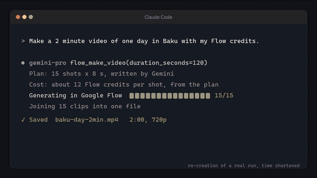

# gemini-pro-mcp

[English](../README.md) · **Türkçe** · [Русский](README.ru.md) · [Azərbaycanca](README.az.md)

**Google AI Pro aboneliğiniz Claude, Codex ve Gemini CLI'ın içinde.** Gemini 4 Argon, Deep Research, Flow videoları, Gemini Notebooks, Jules ve zaten ödediğiniz planın geri kalanı, 36'ya kadar MCP aracı olarak. Tek komutla kurulur.

<p align="center"></p>

<p align="center"></p>

```bash
uvx gemini-pro-mcp setup
```

İşinize yararsa, bir ⭐ diğer AI Pro kullanıcılarının onu bulmasına yardımcı olur.

## Neden

- **Gemini için ek fatura yok.** `gemini_ask`, `gemini_research` ve `gemini_code`, Antigravity CLI üzerinden AI Pro planınızın limitleriyle çalışır, kullandıkça ödenen bir API anahtarıyla değil.
- **Sadece sohbet değil, planın tamamı.** Deep Research, Google Flow (her uzunlukta video ve tüm Flow araçları), Gemini Notebooks (Audio Overview, testler, slaytlar), AI Mode, Jules ve Gemini uygulaması.
- **Kod ajanınız için ikinci bir beyin.** Claude veya Codex, oturumdan çıkmadan Gemini'den kod incelemesi, kaynaklı web araştırması veya bir düzenleme isteyebilir.
- **Tek komutla kurulum, tek komutla kontrol.** `setup` sunucuyu bulduğu her istemciye ekler. `doctor` neyin çalıştığını gösterir ve çalışmayanı nasıl düzelteceğinizi söyler.
- **Varsayılan olarak güvenli.** Gemini dosyaları sandbox içinde okur ve `gemini_code` çağrılmadıkça hiçbir şeyi değiştirmez. Ücretli çağrılar önce izin ister. Tarayıcı araçları siz açana kadar kapalıdır ve sunucu Google şifrenizi asla görmez.

Ajanınızdan şunları isteyin:

> *"`src/auth.py` için Gemini'den ikinci bir görüş al."*
> *"Flutter 3.47'de nelerin değiştiğini kaynaklarıyla araştır."*
> *"Flow kredilerimle karlı bir ormanda yolculuk eden bir tilki hakkında 2 dakikalık video yap."*
> *"Bu üç PDF'i bir Gemini Notebook'a koy ve Audio Overview hazırla."*

## Kurulum

1. [uv](https://docs.astral.sh/uv/) kurun.
2. Gemini araçları için [Antigravity CLI](https://antigravity.google)'ı kurun, `agy` komutunu bir kez çalıştırın ve Google AI Pro hesabınızla giriş yapın.
3. Şu komutu çalıştırın:

```bash
uvx gemini-pro-mcp setup
```

`setup` bilgisayarınızda Claude Code, Codex, Antigravity CLI ve Gemini CLI'ı bulur, sunucuyu her birine ekler ve neyin çalıştığını kontrol eder. Ardından istemcileri yeniden başlatın.

- `--browser`: Flow, Gemini uygulaması, AI Mode ve Notebook araçlarını da açar. Sonra `gemini-pro-mcp flow-login` komutunu bir kez çalıştırıp açılan pencerede Google'a giriş yapın.
- `--auto-approve`: ücretli araçlar sormadan çalışır.
- `--dry-run`: hiçbir şeyi değiştirmeden yapılacakları gösterir.

Daha sonra kontrol etmek için:

```bash
uvx gemini-pro-mcp doctor --flow
```

Medya araçları (`video_generate`, `image_generate`) için [Google AI Studio](https://aistudio.google.com/apikey)'dan bir API anahtarı gerekir. Onu `~/.config/gemini-pro-mcp/.env` dosyasına `GEMINI_API_KEY=...` olarak yazın.

## Daha fazlası

Tüm araçlar, fiyatlar, ayarlar ve Flow bölümü [İngilizce README](../README.md)'de. Katkı vermek isterseniz [CONTRIBUTING.md](../CONTRIBUTING.md)'ye ve [`good first issue`](https://github.com/Muzaqil555/gemini-pro-mcp/labels/good%20first%20issue) etiketli issue'lara bakın. Sorular için [Discussions](https://github.com/Muzaqil555/gemini-pro-mcp/discussions) açık.

Bu bağımsız, açık kaynaklı bir projedir; Google veya Anthropic ile bağlantısı yoktur. Flow araçları Google'ın web sitesini otomatikleştirir; bu, Google'ın kullanım koşullarıyla çelişebilir. Kullanım riski size aittir. Lisans: [MIT](../LICENSE).
